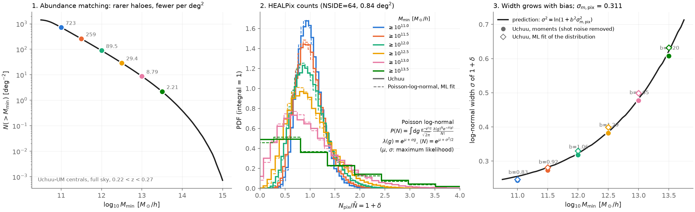
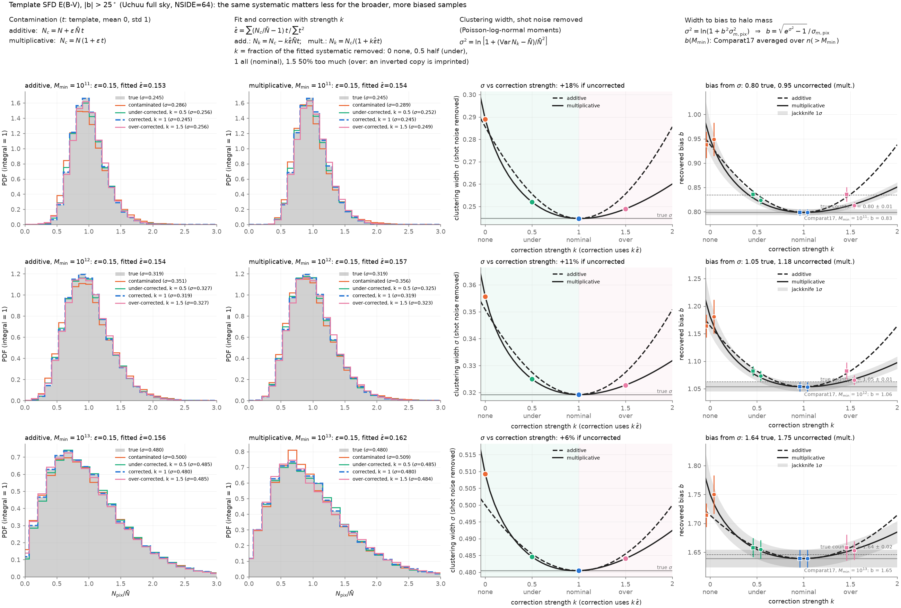
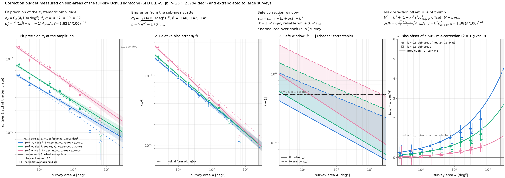

Pedagogy of decontamination
===========================

This page shows, on a simulated sky with no systematic of its own, what a template contamination does to the distribution of galaxy counts per pixel, what its correction recovers, and what an under- or over-correction leaves behind.
It has three figures, each made by one script in ``scripts/``: the link between halo bias and the width of the count distribution, the injection and removal of a systematic, and the correction budget as a function of survey area.

All three use the Uchuu-UM lightcone shell at :math:`0.22 < z < 0.27`, over the full sky (eight octant replications), with central haloes above a minimum mass :math:`M_{\min} = 10^{11}` to :math:`10^{13.5}\,h^{-1}\,M_\odot`, counted in HEALPix pixels at ``NSIDE = 64`` (0.84 deg² per pixel).
The halo mass function and bias are those of Comparat et al. (2017), as implemented in ``colossus``.

Halo bias sets the width of the count distribution
--------------------------------------------------

The first panel gives the abundance matching, :math:`n(>M_{\min})` per deg² against :math:`M_{\min}`.
The second gives the pixel counts normalised to their mean, with a Poisson-log-normal model: Poisson sampling of a log-normal density field.
The third gives the width :math:`\sigma` of the log-normal field, measured with the shot noise removed,

.. math::

   \sigma^2 = \ln\left[1 + \frac{\mathrm{Var}\,N - \bar N}{\bar N^2}\right],

against the prediction :math:`\sigma^2 = \ln(1 + b^2 \sigma^2_{m,\rm pix})`, with :math:`b` the bias averaged over :math:`n(>M_{\min})` and :math:`\sigma_{m,\rm pix}` the matter fluctuation in one pixel.
More massive haloes are more biased, so their count distribution is wider.
Inverting the relation, :math:`b = \sqrt{e^{\sigma^2} - 1}/\sigma_{m,\rm pix}`, turns a measured width into a bias, and hence into a halo mass.

Script: ``python scripts/plot_pedagogy_bias_broadening.py [--nside 64] [--norm integral|peak]``.

Injection, correction, under- and over-correction
-------------------------------------------------

We contaminate the counts of the samples with :math:`M_{\min} = 10^{11}, 10^{12}, 10^{13}\,h^{-1}\,M_\odot` with a real template :math:`t`, normalised to zero mean and unit standard deviation over the footprint at :math:`|b| > 25^\circ`.
The template is the SFD E(B-V) map (default) or the Gaia stellar density.
The two contamination modes read:

.. math::

   N_c = N + \epsilon\,\bar N\,t \quad \text{(additive)}, \qquad
   N_c = N\,(1 + \epsilon\,t) \quad \text{(multiplicative)},

with :math:`\epsilon = 0.15` by default.
The amplitude is fitted by least squares of :math:`N_c/\bar N - 1` against :math:`t`,

.. math::

   \hat\epsilon = \frac{\sum (N_c/\bar N - 1)\,t}{\sum t^2},

and removed with a strength :math:`k`: :math:`N_k = N_c - k\hat\epsilon\bar N t` (additive) or :math:`N_k = N_c/(1 + k\hat\epsilon t)` (multiplicative).
:math:`k` is the fraction of the fitted systematic that is removed: 0 none, 0.5 half (under-corrected), 1 all (nominal), 1.5 half as much again (over-corrected, an inverted copy of the template is imprinted).

The contamination widens the count distribution, and so raises the bias inferred from its width.
The nominal correction brings the width back to the true one.
Both an under- and an over-correction leave a residual template in the map, which widens the distribution again, so the inferred bias is minimal near :math:`k = 1`.
The jackknife errors on the bias are computed over regions of the footprint.

Script: ``python scripts/plot_pedagogy_decontamination.py [--eps 0.15] [--template SFD|GAIA]``.

Correction budget against survey area
-------------------------------------

We repeat the fit of the previous section on 200 sub-areas (HEALPix discs) of the footprint for each area from 25 to 6400 deg², and fit power laws in area:

.. math::

   \sigma_\epsilon(A) = C_\epsilon \left(\frac{A}{100\,\mathrm{deg}^2}\right)^{-\alpha}, \qquad
   \sigma_b(A) = C_b \left(\frac{A}{100\,\mathrm{deg}^2}\right)^{-\beta},

with :math:`\sigma_\epsilon` the scatter of the fitted amplitude and :math:`\sigma_b` the scatter of the recovered bias.
The tolerated contamination is the one that shifts the bias by :math:`\sigma_b`,

.. math::

   \epsilon_{\rm tol}(A) = \sigma_{m,\rm pix}\sqrt{(b + \sigma_b)^2 - b^2},

which defines a safe window :math:`|k - 1| < \epsilon_{\rm tol}/\epsilon` on the correction strength.
The correction is reliable while :math:`\sigma_\epsilon < \epsilon_{\rm tol}`.
The curves are extrapolated to 5000, 14 000 and 20 000 deg².

We also fit the physical form

.. math::

   \sigma_\epsilon^2 = f^2 \left(\frac{1}{\bar N} + e^{\sigma^2} - 1\right) \frac{A_{\rm pix}}{A},

with one factor :math:`f` for the pixel-to-pixel correlations.
The fitted rule is written to ``results/pedagogy_correction_budget_rule.json``.

Script: ``python scripts/plot_pedagogy_correction_budget.py [--eps 0.15] [--ndisc 200]``.
